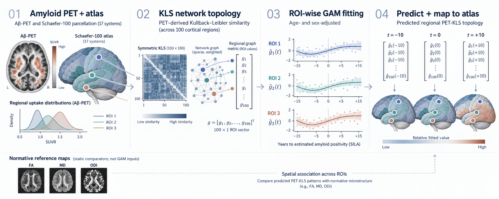

# PET-KLS spatiotemporal brain-map pipeline

This repository models regional PET-KLS network properties across estimated Alzheimer's disease time and compares the fitted spatial patterns with normative biological brain maps. The regional modelling approach can also be adapted to other imaging modalities and network metrics.

**Code:** [Notebook](PETKLS_Brainmaps_notebook.ipynb) · [Configuration-based pipeline](brainmaps_pipeline.py) · [Spatial-null pipeline](pet_kls_brainmaps.py) · [Example configuration](config.example.yaml) · [Environment repository](https://github.com/PET-KLS/env)



*Schematic illustration; the normative microstructure maps shown are examples of static spatial comparators.*

## Workflow

1. **Extract regional metrics.** For PET-KLS, construct symmetric distributional-similarity networks from parcel-wise amyloid PET intensity distributions and calculate node-level topology.
2. **Vectorize by atlas.** Arrange one value per participant and parcel in a consistent Schaefer-100/Yeo-17 order.
3. **Model disease time.** Fit a separate age- and sex-adjusted Gaussian generalized additive model (GAM) for each parcel and graph metric against SILA-estimated years to amyloid positivity.
4. **Predict and remap.** At each disease-time point, assemble the 100 fitted regional values into a vector and map them back to cortical parcels.
5. **Compare with normative maps.** Calculate parcel-wise Pearson correlations between the predicted regional pattern and atlas-aligned biological reference maps; apply spatial-null testing for corrected inference.

These are **fitted population-level trajectories**, not prospective individual predictions. The normative maps are static spatial comparators, **not inputs to the GAMs**.

## Inputs

- Python dependencies in [`requirements.txt`](requirements.txt); also install `PyYAML` for the configuration-based script.
- A consistent [Schaefer-100/Yeo-17 atlas](https://github.com/ThomasYeoLab/CBIG/tree/master/stable_projects/brain_parcellation/Schaefer2018_LocalGlobal) and 100 uniquely matched parcel identifiers (`ROI.Name_17_mod`, `ROI.Name_17`, or `roi`).
- `staging_metrics`: participant-level `subject_id`, `estdtt0`, `age`, `sex`, and 100 ROI columns per metric.
- `group_metrics`: baseline group-comparison sample with `subject_id`, `cdr_glb_score`, `pet_cl_refwc_gca_gaain`, and the same regional metrics. Do not substitute the SILA-only sample.
- Regional metrics with prefixes `participation_coeff_17Networks_`, `betweenness_17Networks_`, `clustering_coeff_17Networks_`, or `strength_17Networks_`.
- Three preprocessed, atlas-aligned normative tables:

| Expected file | Brain maps | Relevant reference resource |
| --- | --- | --- |
| `celltype_density_Yeo17_aggregated.csv` | Cell-type maps | [Allen Brain Cell Types](https://celltypes.brain-map.org/) |
| `gene-expression_Yeo17_aggregated.csv` | Gene expression | [Allen Human Brain Atlas](https://human.brain-map.org/static/download), [abagen](https://abagen.readthedocs.io/) |
| `receptor_density_Yeo17_aggregated.csv` | Receptors and transporters | [Hansen receptor atlas](https://github.com/netneurolab/hansen_receptors) |

These links are reference resources, **not verified sources for the exact aggregated CSVs**; document each derived file's provenance separately. Optional FA, MD, or ODI maps can be added to the descriptive pipeline if aligned to the same parcels. Spatial-null inference also requires compatible bilateral cortical surface/parcellation resources.

## Run

```bash
python -m venv .venv
pip install -r requirements.txt PyYAML
cp config.example.yaml config.yaml
# Set local inputs and outputs in config.yaml
python brainmaps_pipeline.py --config config.yaml
```

Run only one component with `--step temporal` or `--step group`. This script produces **descriptive correlations only**; it does not compute spatial-null p-values or FDR q-values. For the separate PET-KLS analysis with corrected group and dynamic spatial inference:

```bash
python pet_kls_brainmaps.py all --edges data/petkls_edges.csv \
  --brainmap-dir data/brainmaps --out outputs --n-perm 10000
```

The corrected workflow uses bilateral Vasa rotations, a maximum-absolute-correlation statistic across time for dynamic features, and Benjamini–Hochberg FDR correction. Check `--help` and supply inputs matching that script's schema. Group definitions are Healthy (CDR 0, Centiloid < 24) and EarlyAD (CDR 0.5, Centiloid ≥ 24).

## Outputs of `brainmaps_pipeline.py`

| File | Contents |
| --- | --- |
| `regional_gam_predictions.csv` | Regional fitted values across disease time |
| `temporal_spatial_correlations.csv` | Pearson *r* by time, metric, and brain-map feature |
| `temporal_feature_summary.csv` | Mean and peak absolute correlations |
| `group_spatial_correlations.csv` | Healthy/EarlyAD correlations and signed Δ*r* |
| `group_sample_sizes.csv` | Observed group sample sizes |

## Reuse and citation

**KLS is not required downstream.** The ROI-vector → GAM → regional prediction → spatial comparison approach can be adapted to fMRI, diffusion MRI, tau/FDG PET, other network topologies, or non-network regional measures. Adapt the input parser, atlas, staging variable, covariates, and spatial nulls; the scripts are **not drop-in tools for arbitrary modalities**.

The code is available under the [MIT License](LICENSE), permitting use, modification, and redistribution with the copyright and licence notice retained. Third-party datasets, atlases, maps, and dependencies retain their own terms.

For academic use or adaptation, please cite this software using [CITATION.cff](CITATION.cff), the associated Monteiro *et al.* PET-KLS study when available, and the relevant datasets and methods. Citation is an academic request, not an additional condition of the MIT License.

**Method references:** [Schaefer et al., 2018](https://doi.org/10.1093/cercor/bhx179) · [Yeo et al., 2011](https://doi.org/10.1152/jn.00338.2011) · [Hawrylycz et al., 2012](https://doi.org/10.1038/nature11405) · [Hansen et al., 2022](https://doi.org/10.1038/s41593-022-01186-3) · [Markello et al., 2022 (neuromaps)](https://doi.org/10.1038/s41592-022-01625-w) · [SILA implementation](https://github.com/Betthauser-Neuro-Lab/SILA-AD-Biomarker).
